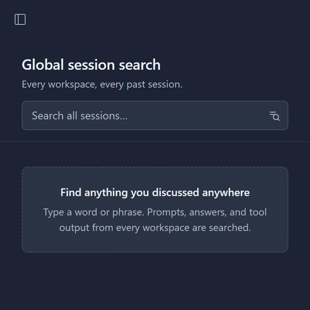
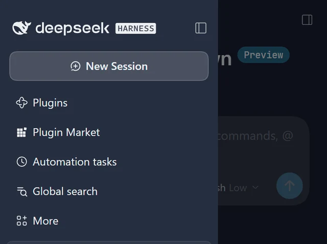

# dsh-global-search

A DeepSeek Harness Web plugin that searches text across **every** session workspace
from one sidebar panel, then opens the matched session in one click.

## Screenshots

## What it does

- Adds a magnifier entry to the sidebar's panel list (`sidebar.panellist`).
- The panel (`main` key `global-search`) searches prompts, assistant answers, and
  tool output from every past session, in every workspace.
- Each row shows the session title, the kind of match, a highlighted snippet, the
  owning workspace, and when it happened. Clicking a row opens that session.
- Results come from a private full-text index: the shipped
  `session-query-sqlite` row keeps its deployment-wide `openAt: never`, so the
  built-in sidebar search and every other consumer are unchanged.

## How it works

| File | Role |
| --- | --- |
| `cordis.patch.yml` | Inserts an isolated group holding a private `session-query-sqlite` index and this plugin's Host row. |
| `index.js` | Host half: registers `GET /dsh-global-search/search` and answers it from the group-local `ctx.sessionQuery`. |
| `client.js` | Client half: locale dictionaries, sidebar entry, and the search panel. |

The Host route pages through `searchSessions` with a stable page size (a provider
cursor is bound to the exact request that produced it), searches the `current`
surface only, and stops at 40 sessions per answer with a `hasMore` flag. Requests
carry a 30-second budget that covers the one-time index build.

The index is a disposable cache at `<DSH_HOME>/cache/global-search-index.sqlite`.
The first search in a fresh profile builds it (a few seconds to ~20 seconds for a
hundred-plus sessions); later searches answer in well under a second. Deleting the
file only costs a rebuild.

## Configuration

The route accepts `q` (2–200 characters, required) and `limit` (1–60, default 30).
Row-level configuration lives in `cordis.patch.yml` and can be overridden by the
profile's patch layer.

## Verification status

- JavaScript syntax, manifest, patch YAML, and locale JSON validated.
- Bundle installs with `application: applied`; both Client slot entries are live.
- The route returns ranked cross-workspace hits (curl-verified) and refuses empty,
  overlong, cross-site, and non-GET requests.
- The screenshots above show the rendered panel and sidebar entry. The panel uses
  only `--dsw-alias-*` theme tokens and reads its texts through the Client locale
  service (English and Chinese dictionaries shipped).
